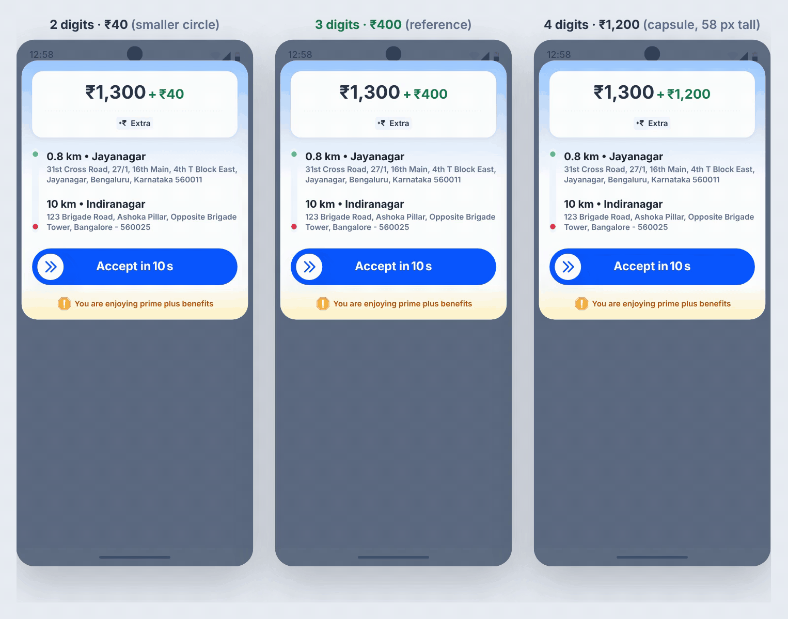

# Fare Booster – extra amount motion

Compose Multiplatform implementation of the **“+₹400” extra amount** animation on the partner app's
accept order pop-up: after a 500 ms delay, every 1,250 ms the amount pulses, a highlight sweeps through
the digits and a ripple ring appears around it — forever, while the pop-up is on screen.



| | |
|---|---|
| Design spec (Figma) | [Fare Booster – Extra amount motion spec v2](https://www.figma.com/design/3o84iYg6IYYBpD84E228mS/Partner-Fare-Booster?node-id=2594-19) · text copy in [SPEC.md](SPEC.md) |
| Live prototypes | [2, 3 and 4 digits side by side](https://claude.ai/artifact/DzDgzUuK8JL7BXsVCDc5xK) · [single screen with amount switcher](https://claude.ai/artifact/7deUhzk3UEdqH7kTv9Dfq5) |
| Videos | [Built prototype, 3 amounts](media/preview-2-3-4-digits.mp4) · [After Effects render](media/after-effects-render.mp4) |
| AI agents | Read [AGENTS.md](AGENTS.md) first |

## Use it

```kotlin
Row(verticalAlignment = Alignment.Bottom, horizontalArrangement = Arrangement.spacedBy(3.dp)) {
    Text("₹1,300", style = Display28)
    FareBoosterExtraAmount(
        amount = "₹400",          // include ₹ and commas: "₹40", "₹400", "₹1,200"
        shownKey = order.id,      // restart from 0 ms each time a pop-up is shown
        animate = !reduceMotion,  // respect the OS animation setting
    )
}
```

## What's inside

```
motion/   Compose Multiplatform library (Android, iOS, desktop)
  ExtraAmountMotionSpec.kt   every number from the design spec
  ExtraAmountTimeline.kt     pure timing + ring-size math (no UI; easy to port to any platform)
  FareBoosterExtraAmount.kt  the composable: pulse, shimmer, ripple
  ExtraAmountTimelineTest    spec acceptance tests
sample/   desktop app showing ₹40 / ₹400 / ₹1,200
web/      HTML reference implementations (open in any browser)
media/    preview GIF + MP4s
```

## The motion in one table

| | 0 ms | 133 | 250 | 400 | 500 | → 1,250 |
|---|---|---|---|---|---|---|
| Pulse “+₹400” | 100% | 120% | 100% | | | pause |
| Shimmer (43 × 47, 60%, inside digits) | left − 22 | | | right + 22 | | pause |
| Ripple ring opacity | 0 | | 60% | | 0 | pause |
| Ripple ring scale / shape | 94%, pill | | | | 104%, circle or capsule | pause |

Easing for every move: `cubic-bezier(0.33, 0, 0.67, 1)`. Ring: solid 1 dp `#157A4E`, hugs the amount
(+6 dp each side, 23 dp tall), ends ≤ 58 dp tall — 4-digit amounts end as a 58 dp capsule so the ring
never cuts a character.

## Run

```bash
./gradlew :motion:desktopTest     # spec tests
./gradlew :sample:run             # desktop preview of the three amounts
```

Requires JDK 17. CI runs the tests and compiles Android + desktop on every push.

## Notes

- Use the app's **PP Mori** font: ring sizes in the spec are measured from it. Other fonts change the amount width;
  the rules still hold.
- The web references use a system font, so their rings are a few px larger than the spec.
